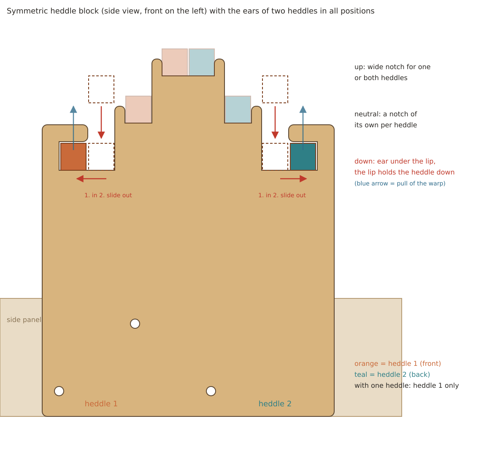
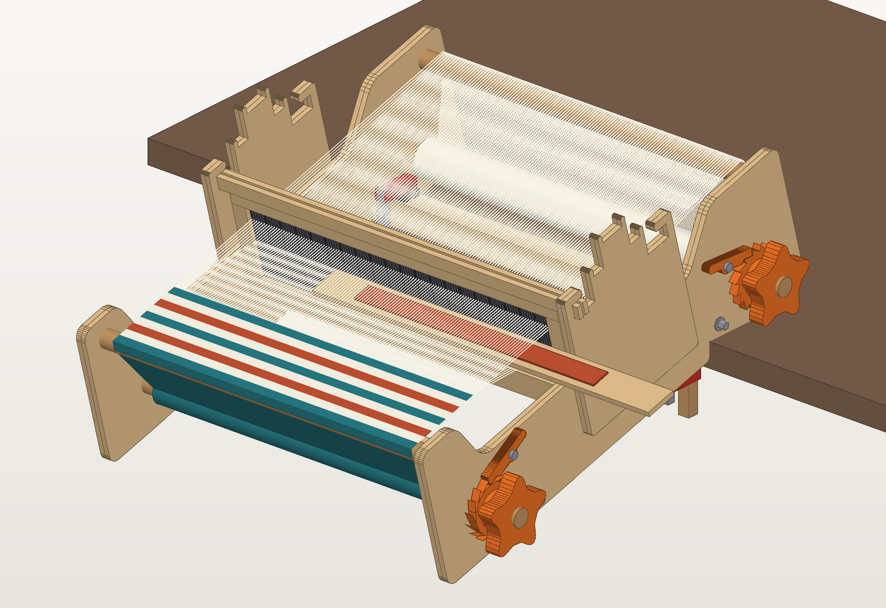
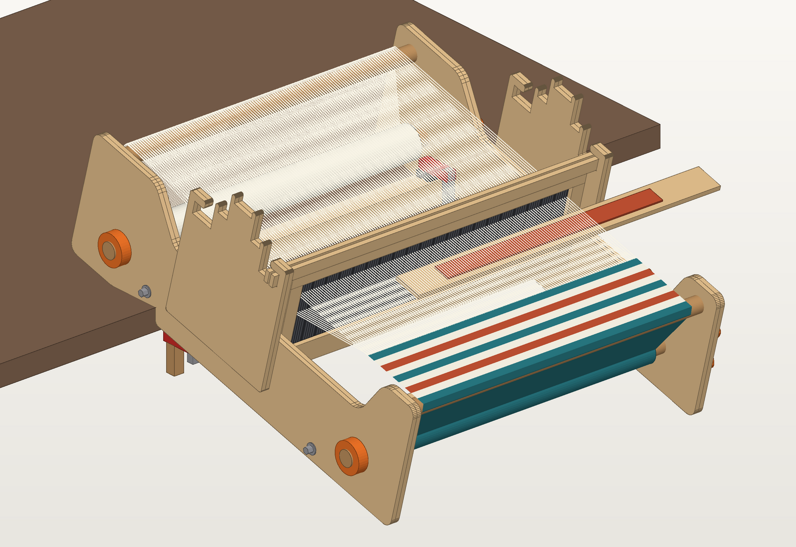
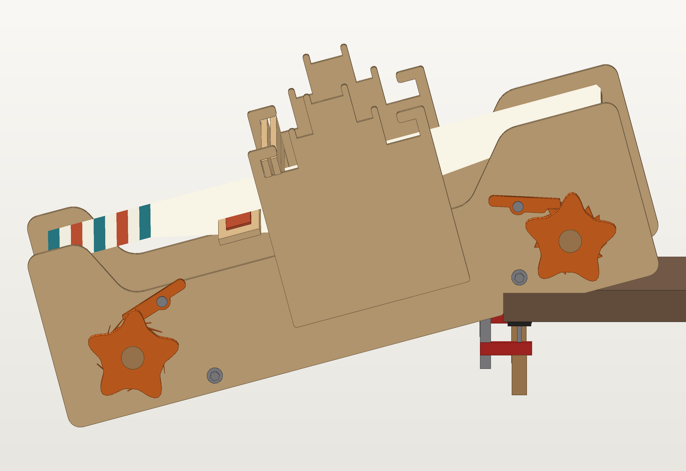
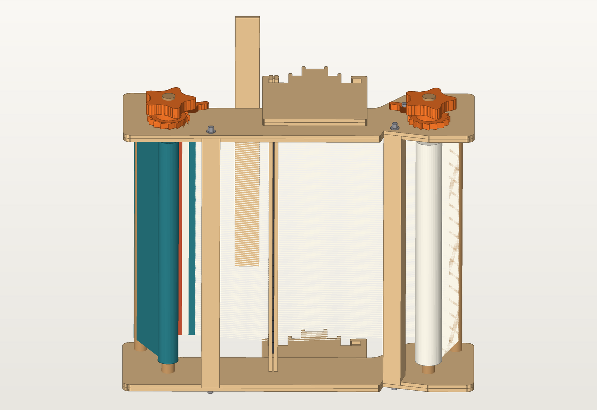
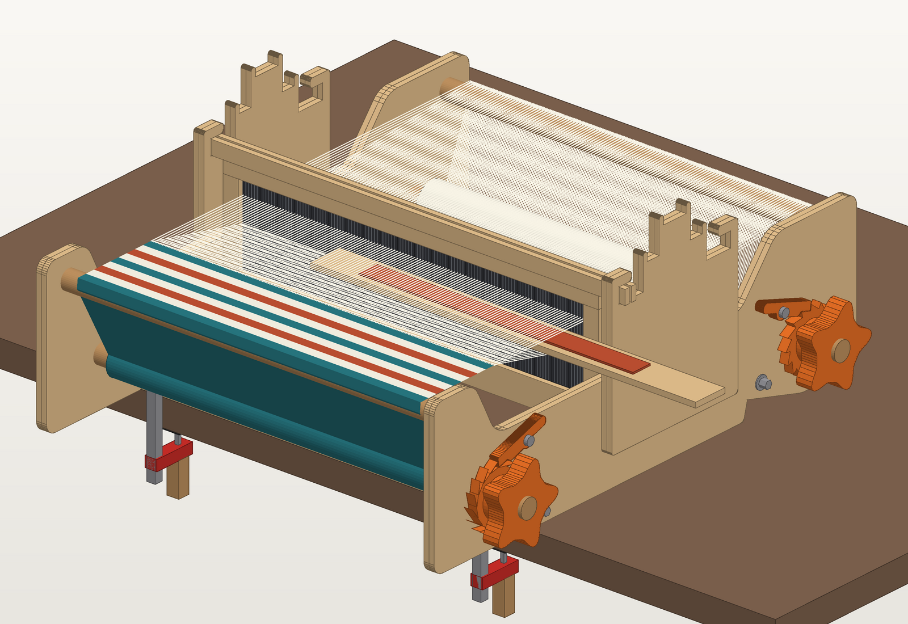
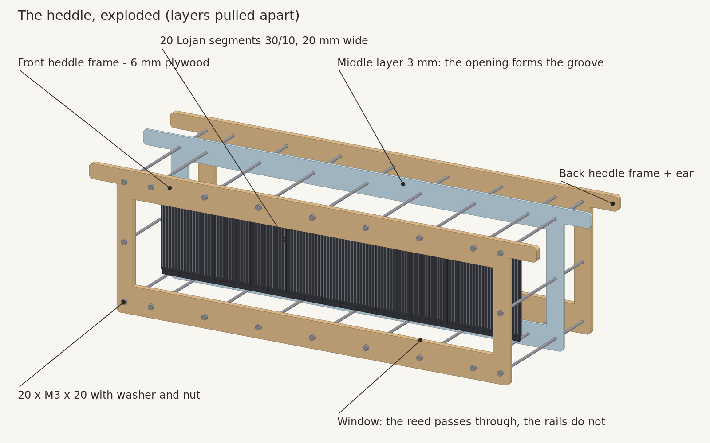
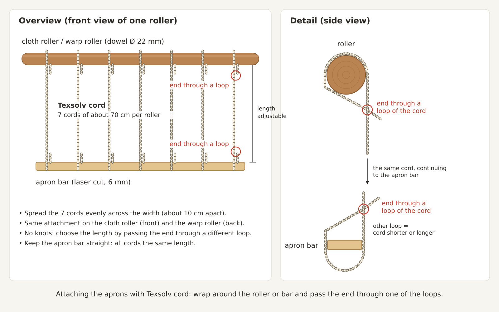

# Rigid heddle loom (40 cm)

A table loom with a rigid heddle that you build yourself with a laser cutter (600 × 400 mm) and a
3D printer. A Dutch version of this manual is in [README_dutch.md](README_dutch.md).

- Weaving width: 400 mm
- Heddle: 20 separate Lojan heddle segments, 30 dents per 10 cm (≈ 7.5 dpi), 120 dents, for DK and
  worsted yarn. Lojan sells the segments separately in 10/10 to 60/10, so you can change the sett
  without making a new heddle.
- Size: about 580 × 500 × 255 mm (l × w × h), without knobs

## Files

| File | What | Material |
|---|---|---|
| `laser/sheet1_side_panels_inner_6mm.svg` | 2 inner layers of the side panels (holes for breast and back beam, cut-outs for the clamp beams) | plywood 6 mm |
| `laser/sheet2_side_panels_outer_6mm.svg` | outer layer right and left (mirrored), with screw holes | plywood 6 mm |
| `laser/sheet3_heddle_frames_6mm.svg` | 2 heddle frames (in front of and behind the segments) | plywood 6 mm |
| `laser/sheet4_box_slats_accessories_6mm.svg` | 8 finger-jointed slats for the 2 clamp-beam boxes, 2 apron bars, pick-up stick | plywood 6 mm |
| `laser/sheet5_heddle_blocks_shuttles_6mm.svg` | 4 layers for the 2 heddle blocks (for 1 or 2 heddles), 2 shuttles of 38 cm | plywood 6 mm |
| `laser/sheet6_heddle_middle_layer_3mm.svg` | middle layer of the heddle; the opening forms the groove for the segments | acrylic 3 mm |
| `laser/test_piece_heddle_frame_6mm.svg` + `test_piece_heddle_middle_layer_3mm.svg` | test piece for 3 segments to check the fit | plywood 6 mm + acrylic 3 mm |
| `print/ratchet_front.stl`, `ratchet_back.stl` | ratchet wheels for cloth roller and warp roller (mirror images), 1 of each | PETG or PLA |
| `print/pawl.stl`, `knob.stl`, `collar.stl` | print-ready parts, print 2 of each | PETG or PLA |
| `print/filing_jig.stl` | jig to file the flats on the shafts, print 1 | PETG or PLA |
| `print/generate_stl.py` | script that makes the STLs (dimensions adjustable) | – |
| `print/loom_print.scad` | the same parts for OpenSCAD (optional, untested) | – |
| `generate_laser.py` | script that makes all SVGs | – |
| `render_3d.py` | makes the impressions (`python3 render_3d.py`, with `side`, `left`, `bottom` or `warping` for other views) | – |
| `render_heddle.py` | makes the exploded 3D view of the heddle | – |
| `draw_heddle_block.py` | makes the detail drawing of the heddle block | – |
| `draw_aprons.py` | makes the diagram of the apron attachment with Texsolv cord | – |
| `PROMPT.md` | reusable prompt with all design decisions, to continue later with an AI assistant | – |
| `README_dutch.md` | this manual in Dutch | – |

Colours in the SVGs: **red = cut**, **blue = engrave** (the labels; you may switch them off).
The sheets are 600 × 400 mm with a 10 mm margin.

Make everything again after a change:

```bash
python3 generate_laser.py && (cd print && python3 generate_stl.py) && for v in "" side left bottom warping; do python3 render_3d.py $v; done && python3 render_heddle.py && python3 draw_heddle_block.py && python3 draw_aprons.py
```

## First: measure and adjust

1. **Measure your plywood** with calipers. "6 mm" is often 5.7–6.3 mm. Enter the real thickness as
   `T` at the top of `generate_laser.py`. The fingers of the box slats and the cut-outs scale with it.
2. **Measure the kerf** of your laser, separately for each material: cut a 20 mm square and
   measure it. Enter the value for plywood as `KERF` and the value for acrylic as `KERF_ACRYLIC`
   (measured: 0.15 mm in 6 mm plywood and 0.30 mm in 3 mm acrylic). Openings and holes are
   compensated for it.
3. Run the script again:

   ```bash
   python3 generate_laser.py
   ```

4. **Cut the test piece first** for 3 segments: two frames in plywood and a middle layer in
   acrylic. Bolt it around 3 segments with 4 × M3 (see build step 5). The segments should lie
   side by side without play but without being squeezed, and the rails should drop into the
   groove. Too tight or too loose? Adjust `SEG_CLEARANCE`. The segment dimensions are at the top
   of `generate_laser.py` (`SEG_W`, `SEG_H`, `SEG_RAIL_H`, `SEG_RAIL_T`, `SEG_REED_T`).

## Shopping list

| What | Quantity |
|---|---|
| Birch plywood 6 mm, 600 × 400 mm | 5 sheets |
| Lojan heddle segments 30/10, 20 mm wide (sold separately in 10/10 to 60/10) | 20 pieces |
| Acrylic 3 mm (heddle middle layer), at least 500 × 150 mm | 1 piece |
| Beech dowel Ø 22 mm (measured 21.7 mm): 2 × 540 mm (rollers) and 2 × 452 mm (breast and back beam); 2 rods of 1 m are enough | 2 m |
| Wood screws 5 × 50 mm (end grain of breast and back beam) | 4 |
| M5 threaded rod, 2 × about 480 mm (from 1 m) | 1 m |
| M5 penny washers + M5 dome nuts (clamp beams) | 4 + 4 |
| M3 × 20 bolts + nuts + washers (heddle 20, aligning the side panels 6) | 26 |
| M5 × 30 bolts + 2 washers + lock nut (pawl pivot) | 2 |
| M5 × 35 bolts + washers + nuts (heddle blocks) | 6 |
| Wood screws 3.5 × 25 mm (locking screw in ratchet wheel, knob and collar) | 6 |
| F-clamps, reach ≥ table thickness + 50 mm | 2 |
| Texsolv cord (apron cords) | 10 m |
| Wood glue, sandpaper (180/240) | |

## Material costs (estimate)

Prices are an estimate for the Netherlands (November 2026), including VAT. Laser and print time on
your own machines are not included.

| What | Price | Total |
|---|---|---|
| Birch plywood 6 mm, 600 × 400 mm, 5 sheets | € 6–9 per sheet | € 30–45 |
| Acrylic 3 mm (heddle middle layer) | offcut or small sheet | € 5–15 |
| Lojan heddle segments 30/10, 20 pieces | € 0.90 each | € 18 |
| Beech dowel Ø 22 mm, 2 m | € 3–5 per m | € 6–10 |
| M5 threaded rod (1 m), 4 penny washers, 4 dome nuts | | € 4–6 |
| 26 × M3 × 20 with nuts and washers | | € 4–7 |
| 8 × M5 bolts with washers, nuts and lock nuts | | € 4–7 |
| Wood screws (4 × 5 × 50, 6 × 3.5 × 25) | | € 2–4 |
| Texsolv cord, 10 m | € 0.80–1.20 per m | € 8–12 |
| Filament PETG or PLA, about 270 g | € 20–25 per kg | € 5–7 |
| Wood glue and sandpaper | | € 5–8 |
| **Total** | | **about € 90–140** |

- **F-clamps**: 2 cost about € 16–30, if you don't have them yet.
- **Second heddle** (optional): 20 segments (€ 18), an extra plywood sheet for the heddle frames
  (€ 6–9), an acrylic middle layer (€ 5–15) and 20 × M3 × 20 (€ 3–5): about € 32–47 extra.
- Changing the sett only costs the segments: 20 × € 0.90 = € 18 per heddle.

## Construction in short

```
   front (weaver)                                    back
                           heddle block (outside of side panel)
                  down 1 · neutral 1 · up 1 · up 2 · neutral 2 · down 2
                           ┌───────────────────────────┐
   breast beam             │   notches for 2 heddles   │          back beam
   (O)_____________________│                           │___________(O)
      \                    └───────────────────────────┘

      (O) cloth roller                             (O) warp roller
                                       [clamp beam]
```

- **Side panels**: each 2 layers of 6 mm, glued to 12 mm. Breast and back beam and the clamp beams
  sit 6 mm deep in the inner layer; the outer layer holds them in.
- **Breast and back beam**: the same Ø 22 mm beech dowel as the rollers, 452 mm long, with the top
  at warp height. Round wood is smooth for the yarn. A 5 × 50 wood screw through the outer layer
  into the end grain holds them in place.
- **Clamp beams**: 30 × 30 mm boxes made of 4 finger-jointed slats (2 × A and 2 × B per box),
  glued. An M5 threaded rod runs through the box and both side panels and is fixed on each side
  with a penny washer and a dome nut. The rod pulls the side panels firmly against the boxes; the
  frame can still be taken apart.
- **Rollers**: Ø 22 mm dowel (measured 21.7 mm) through Ø 22.7 mm holes. On the right there is a
  ratchet wheel and a knob, on the left a collar. The right end gets two filed flats (double-D,
  18.5 mm between the flats) and the ratchet wheel and knob have a matching bore, so they can't
  slip. A locking screw in each hub keeps them in place.
- **Heddle**: 20 separate **Lojan** heddle segments (sold separately in 10/10 to 60/10), clamped
  between three layers: front heddle frame (6 mm), middle layer (3 mm acrylic) and back heddle
  frame (6 mm), 15 mm thick together. A segment is 20 mm wide and 100 mm high: a top and bottom
  rail of 5 mm high and 3 mm thick, with the reed of 90 mm high and 5 mm thick in between.
  - The **middle layer** has an opening of 400.5 × 100.5 mm that the row of segments fits exactly.
  - The **heddle frames** have a smaller window (402.5 × 91 mm). The reed passes through it, but
    the rails don't: they sit between the two frames, in the groove formed by the middle layer.
  - So you don't have to slide the segments into a groove: you lay them on the back frame and
    bolt the front frame on top. A different sett? Undo the bolts and swap the segments.

  The heddle body fits between the side panels; only at the top an **ear** sticks out on each
  side. You beat the weft with the heddle itself; there is no separate beater.
- **Heddle blocks**: on the outside of each side panel there is a heddle block (2 layers, bolted
  on). The ears rest in it. **Two heddles** fit: heddle 1 in front and heddle 2 behind. If you
  weave with one heddle, use only the positions of heddle 1. The block is **symmetric**: from
  front to back down 1 · neutral 1 · up 1 · up 2 · neutral 2 · down 2, with the up positions in
  the middle and the down positions at the ends.
  - **down** (lower shed): put the ears into the entry and slide the heddle about 2 cm
    **outwards**, towards the end of the block (heddle 1 forward, heddle 2 back). The ears are
    then under the lip at the end of the block. The threads in the holes pull the heddle up, but
    the lip holds it in place. To take it out: slide it inwards and lift.
  - **neutral**: an open notch per heddle, for warping and threading, or as the rest position of
    one heddle while the other is working.
  - **up** (upper shed): one wide notch in the middle, wide enough for both heddles side by side;
    the warp pushes the heddle(s) into it. Heddle 1 sits in the front half (up 1), heddle 2 in the
    back half (up 2).

  So heddle 1 is always in front of heddle 2 in every combination, and each heddle can be up,
  neutral or down independently of the other. Heddle 2 sits 2–14 cm behind heddle 1, depending
  on the positions. The block is 173 mm long.

  
- **Free beating**: the side panels are low between the breast beam and the heddle block
  (110 mm). The ears always stay well above the side panels, so you can lift the heddle slightly
  out of any position (6–8 mm) and move it all the way forward. The shuttle comes out of the shed
  above the side panels, in front of the heddle blocks.
- **Table notch**: at the back of the bottom edge there is a slanted notch. The front of the loom
  rests on your lap and the table edge drops into the notch. The slanted face then lies flat on
  the table top and the short wall hooks behind the table edge, so the loom doesn't slide across
  the table. The notch is designed for a 15° tilt (lap about 12 cm lower than the table top). Set
  other dimensions with `TABLE_ANGLE`, `TABLE_X` and `TABLE_DEPTH`.
- **Clamp beam and F-clamps**: the lower beam sits directly behind the table notch and lies with
  its bottom flat on the table top. On each side, right next to the side panel, put an F-clamp
  over the clamp beam and under the table top. The clamp bar is then in front of the table edge,
  between the side panels, and doesn't hit anything. The clamp beam is also the lower cross
  member of the frame. In the inner layer of the side panels the cut-out for this beam is open
  towards the bottom.
- **Front clamp beam (warping)**: a second clamp beam sits at the bottom behind the cloth roller,
  with its bottom flush with the bottom edge of the side panels. Put the loom flat on the table
  with the table edge just in front of this beam (the loom then sticks out about 13 cm over the
  edge) and fix it with an F-clamp on each side over the beam. The clamp bar is in front of the
  table edge, between the side panels and behind the cloth roller.













## Building

1. **Side panels**: put an inner and an outer layer together, push the M3 alignment bolts through
   the 3 small holes, glue and clamp them. Make a left and a right panel (mirror images: the inner
   layer is always on the inside; the front is the side with the breast beam). The outer layers
   are already cut as left and right: place them with the **engraved label facing out** (it ends up behind the heddle block) and don't flip
   them. You may flip an inner layer to make it fit.
2. **Boxes**: first make a test corner from two slats to check the fit of the fingers. Then glue
   4 slats into a box each time (2×): the two A slats opposite each other (top and bottom), the
   two B slats between them (sides). Check that the box is square and let the glue dry well.
3. **Frame**: saw the dowel for the breast and back beam to 452 mm and push it into the holes of
   the inner layers. Pre-drill Ø 3 mm through the hole in the outer layer into the end grain and
   screw it on (5 × 50). Put the boxes into their cut-outs (from below), push the threaded rod
   through and tighten a washer and dome nut on both sides. Not too tight: the side panels must
   stay straight.
4. **Heddle blocks**: glue 2 layers together into a heddle block each time (2×). Place them on
   the outside of the side panels and bolt them on with 3 × M5 × 35. The block is symmetric, but
   the bolt holes are not: they sit closer to the front end of the block. The bolt holes are
   in the same place as on the earlier heddle blocks, so you can replace those without changing
   the side panels.
5. **Heddle**: sand the inside edges of the windows smooth. Lay the back frame flat, put the
   middle layer on it and push a few bolts through to align them. Lay the 20 segments into the
   opening of the middle layer, with the rails on the back frame. Put the front frame on top and
   bolt everything together with 20 × M3 × 20; tighten the bolts evenly and not too hard. Check
   that the ears drop freely into all positions and slide smoothly under the lip in the down
   position. For weaving with two heddles, make the heddle twice (cut sheet 3 and sheet 6 twice,
   20 extra segments and 20 extra M3 × 20).
6. **Rollers**: saw the dowel to 540 mm.
   - **Filing the flats**: slide the filing jig over the right end until the shaft touches the
     bottom, and clamp the jig (or the shaft) in a vice. File the wood away through one window
     until it is level with the edges of the window, turn it over and do the same on the other
     side. Use a flat wood file or sandpaper on a board and file lengthwise. The flats then become
     60 mm long, about 1.6 mm deep and exactly parallel.
   - **Mounting**: push the roller through both side panels with the flats on the right. On the
     right slide on a washer, the ratchet wheel (hub facing out) and the knob, and on the left
     the collar.
   - **Locking**: pre-drill Ø 2 mm through the locking hole in each hub into the wood and drive in
     a 3.5 × 25 wood screw. The hole is centred on a flat, so the screw presses the part against
     the flat. The screw only keeps the part in place; the double-D flat takes the torque.
7. **Pawls**: fit the pawls with an M5 bolt, washer and lock nut in the pivot holes (right side),
   with washers so the pawl lies in the same plane as the ratchet wheel. Tighten the lock nut so
   that the pawl still drops freely. The pawl must fall into the teeth by gravity.
   - Note: the tension pulls the cloth roller and the warp roller back in **opposite directions**.
     So put `ratchet_front` on the cloth roller and `ratchet_back` on the warp roller; they are
     mirror images. Flipping one doesn't work, because the hub would then be against the side
     panel.
   - Flip one of the two pawls (other side facing out), so that on both the tip falls against the
     steep side of the teeth and the tab to lift it points up at an angle.
   - The tip of the pawl has the shape of the space between two teeth: its face lies flat against
     the steep side of a tooth and its underside follows the ramp of the next tooth. So it drops
     almost to the bottom of the tooth (5.5 of the 6 mm) and the load pulls it further in instead of
     pushing it out. The rest of the pawl has a flat top and rounded shapes.
   - Check: with the knob you can **wind up** the cloth on the cloth roller and the warp on the
     warp roller, while the pawl stops it from turning back.
8. **Aprons**: cut 7 pieces of Texsolv cord of about 70 cm per roller and spread them evenly
   across the width (about 10 cm apart). Wrap one end around the roller and pass it through one
   of the loops of the cord itself; do the same with the other end around the apron bar. Set the
   length by choosing a different loop, so that the bar reaches just past the breast beam (front)
   or the heddle (back) and hangs straight. You don't need any knots and can easily adjust later.

   

## 3D printing

The STLs in `print/` are ready to print. Print 2 of these parts (one per roller): `pawl.stl`,
`knob.stl` and `collar.stl`. Print `ratchet_front.stl`, `ratchet_back.stl` and `filing_jig.stl`
once each.

- The pawl tip is calculated from the ratchet teeth and the position of the pivot
  (`pawl_tip_geometry()` in `generate_stl.py`, clearance `PAWL_CLEARANCE`). If you change the
  teeth or the pivot holes, the pawl changes along with them.
- Ratchet wheel and knob have a double-D bore (18.9 mm between the flats) and a 3.8 mm locking
  hole in the hub. The collar has a round bore with a locking hole.
- Print the filing jig upright with its base on the bed. The windows run to just below the top
  edge; that short bridge prints without supports.
- To change dimensions, for example the bore: change the values at the top of
  `print/generate_stl.py` and make the STLs again (no OpenSCAD needed):

  ```bash
  python3 generate_stl.py
  ```

- PETG or PLA, 0.2 mm layer height, 4 walls, 40 % infill
- Ratchet wheel and knob flat on the bed with the hub facing up; no supports needed
- The bore is 22.1 mm. If it is too tight on your dowel, increase `CLEARANCE`. If you want the
  flats further apart or closer together, change `FLAT_DISTANCE`; the filing jig and the bores
  change along with it

## Weaving tips

- Start with a firm, smooth yarn (cotton or wool in DK/worsted). Fuzzy mohair is tricky in a
  heddle.
- Warping is direct (direct warping): put a clamp with a peg 1.5–2 m from the loom and pull loops
  through the slots.
- Tension matters: turn the warp roller until the warp is tight as a drum and make sure all
  threads are equally tight.
- Weaving: alternate between **up** and **down** for each pick. In the down position always slide
  the heddle outwards a little (heddle 1 forward), so the ears are under the lip.
- Two heddles (double width, or patterns): the second heddle sits behind the first. Follow your
  pattern's chart for which heddle is up, neutral or down; every combination fits in the heddle
  blocks.

## Design decisions

- The reed itself is bought (Lojan segments) instead of laser cut or printed. A laser-cut acrylic
  reed turned out to warp during cutting, and a printed reed frays the yarn on the layer lines.
  With separate segments you can also easily change the sett.
- All long parts fit in one piece on a 600 × 400 mm bed.
- Outer corners are rounded (side panels 12–25 mm, heddle blocks and heddle 3–4 mm, sticks and
  shuttles 3 mm). Corners that must fit stay sharp: the cut-outs for the beams, the inside corner
  of the table notch and the inside corners of the heddle-block notches. Change the radii in
  `side_panel_outline()` or with `convex=`/`concave=` in `rounded(...)`. Lightly sand all edges
  with 180–240 grit after cutting, so the plywood feels nice.
- A different sett: buy other Lojan segments; set `DENTS_PER_10CM` to the new value only for the
  images. A different weaving width: change `SEG_N` (weaving width = `SEG_N` × 20 mm). Note: above
  about 480 mm weaving width the heddle (with ears) no longer fits on the bed.

## License

This project is licensed under [CC BY-NC 4.0](https://creativecommons.org/licenses/by-nc/4.0/):
you may share and adapt it with attribution, but not for commercial purposes. See [LICENSE](LICENSE) for the full legal code.

Copyright (c) 2026 Ernest Neijenhuis.

"Lojan" is a brand name of its owner and is used only to identify the heddle segments this design
is made for; this project is not affiliated with Lojan.
