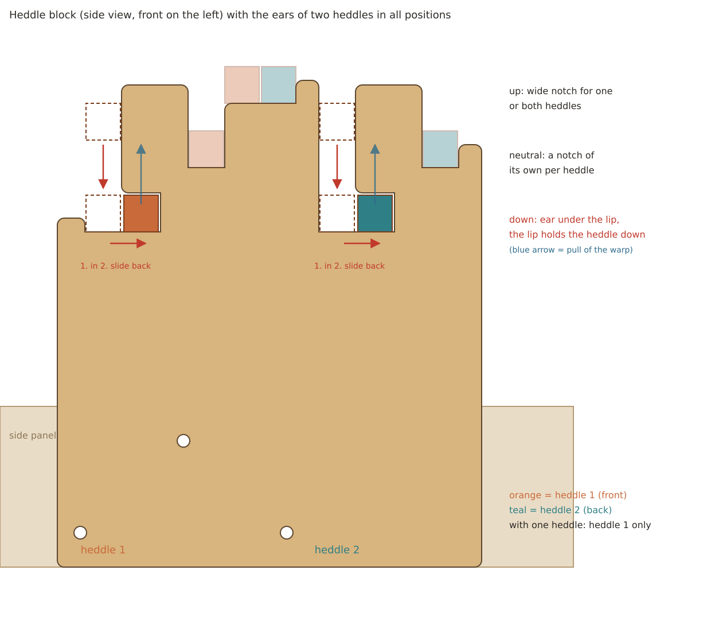
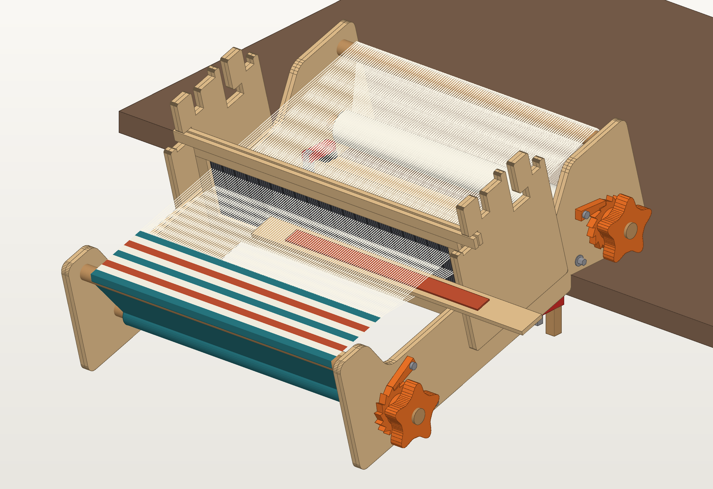
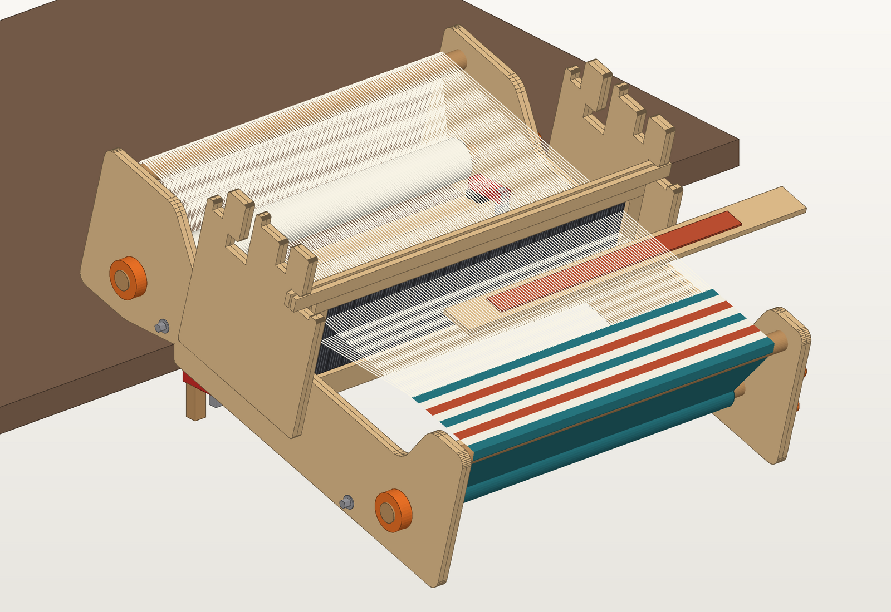
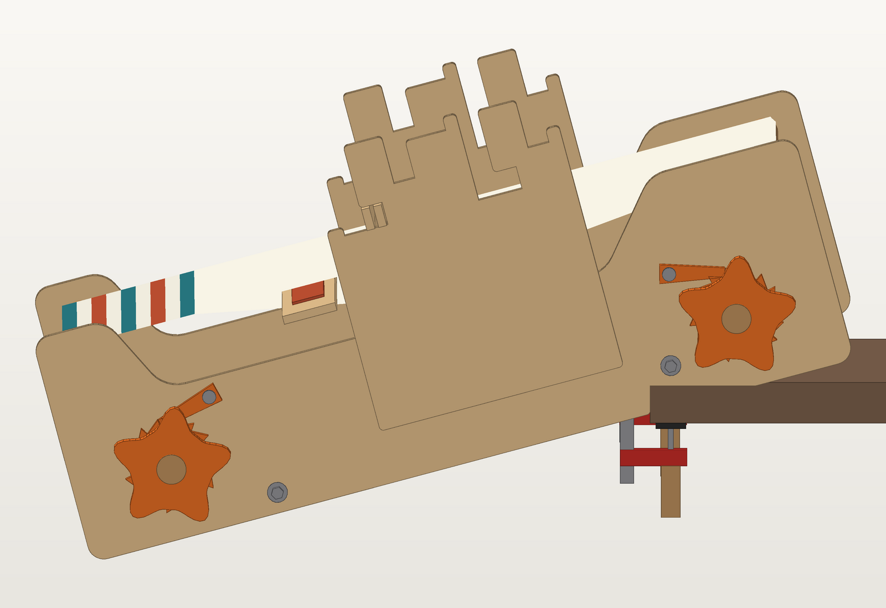
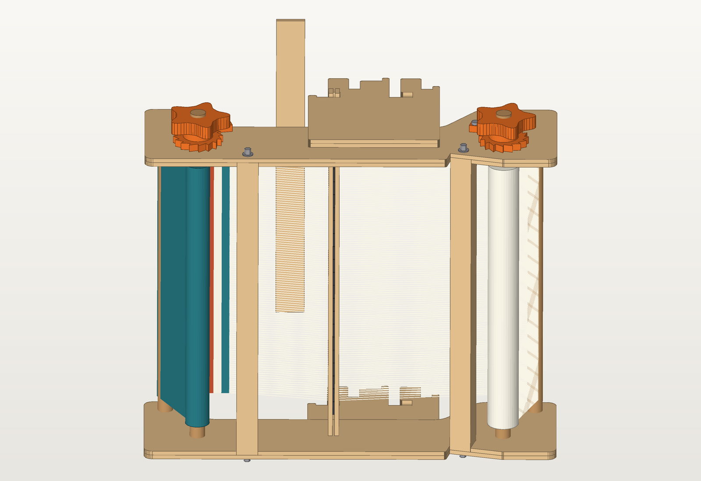
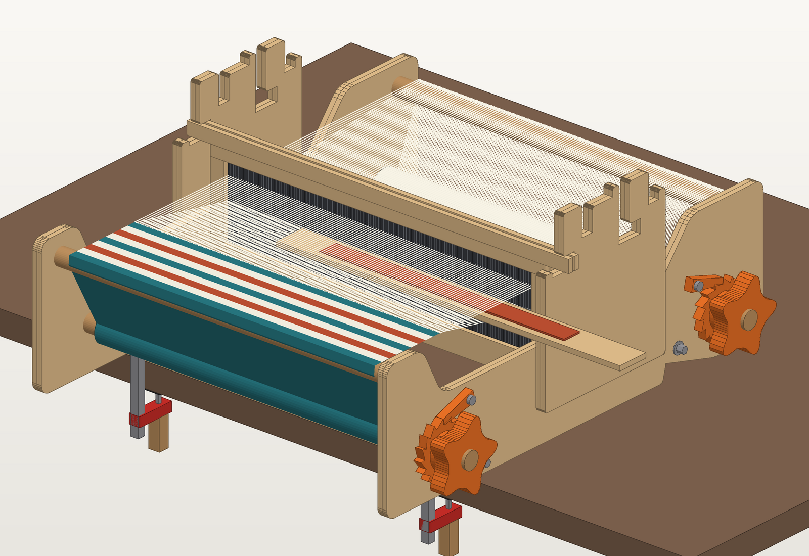
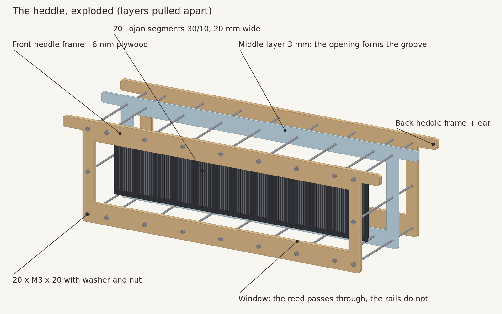
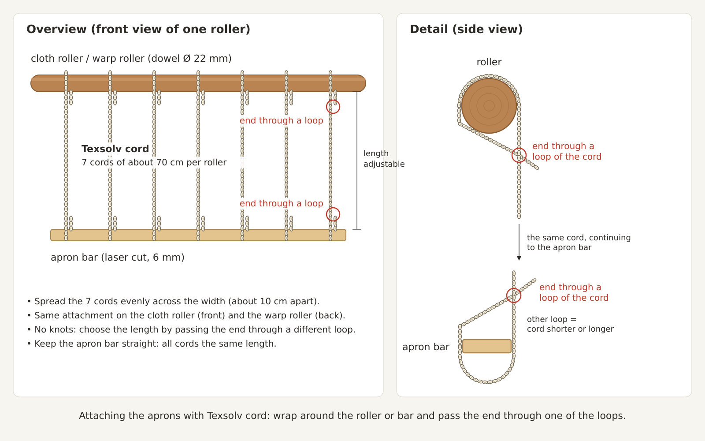

# Rigid heddle weefgetouw (40 cm)

Een tafelweefgetouw met een starre kam (rigid heddle) om zelf te maken met een lasercutter
(600 × 400 mm) en een 3D-printer. De Engelse versie van deze handleiding staat in
[README.md](README.md).

- Weefbreedte: 400 mm
- Kam: 20 losse hevelrietsegmenten van Lojan, 30 dents per 10 cm (≈ 7,5 dpi), 120 dents, voor
  DK- en worstedgaren. Lojan verkoopt de segmenten los in 10/10 t/m 60/10, dus je kunt van
  fijnheid wisselen zonder de kam opnieuw te maken.
- Afmetingen: ca. 580 × 500 × 255 mm (l × b × h), zonder knoppen

## Bestanden

| Bestand | Wat | Materiaal |
|---|---|---|
| `laser/sheet1_side_panels_inner_6mm.svg` | 2 binnenlagen zijplaat (gaten voor borst- en rugboom, uitsparingen voor de klembalken) | multiplex 6 mm |
| `laser/sheet2_side_panels_outer_6mm.svg` | buitenlaag rechts en links (gespiegeld), met schroefgaten | multiplex 6 mm |
| `laser/sheet3_heddle_frames_6mm.svg` | 2 kamframes (voor en achter de segmenten) | multiplex 6 mm |
| `laser/sheet4_box_slats_accessories_6mm.svg` | 8 latjes met vingers voor de 2 klembalk-kokers, 2 schortstokken, pick-up stok | multiplex 6 mm |
| `laser/sheet5_heddle_blocks_shuttles_6mm.svg` | 4 lagen voor de 2 kamblokken (voor 1 of 2 kammen), 2 pendels van 38 cm | multiplex 6 mm |
| `laser/sheet6_heddle_middle_layer_3mm.svg` | middenlaag van de kam; de opening vormt de groef voor de segmenten | acrylaat 3 mm |
| `laser/test_piece_heddle_frame_6mm.svg` + `test_piece_heddle_middle_layer_3mm.svg` | proefstuk voor 3 segmenten om de passing te testen | multiplex 6 mm + acrylaat 3 mm |
| `print/ratchet_front.stl`, `ratchet_back.stl` | palraderen voor doekrol en kettingrol (spiegelbeeld), van elk 1 | PETG of PLA |
| `print/pawl.stl`, `knob.stl`, `collar.stl` | printklare onderdelen, van elk 2 printen | PETG of PLA |
| `print/filing_jig.stl` | mal om de vlakken op de assen te vijlen, 1 printen | PETG of PLA |
| `print/generate_stl.py` | script dat de STL's maakt (maten aanpasbaar) | – |
| `print/loom_print.scad` | dezelfde onderdelen voor OpenSCAD (optioneel, ongetest) | – |
| `generate_laser.py` | script dat alle SVG's maakt | – |
| `render_heddle.py` | maakt de opengewerkte 3D-weergave van de kam | – |
| `draw_heddle_block.py` | maakt de detailtekening van het kamblok | – |
| `draw_aprons.py` | maakt de uitleg van de schortbevestiging met Texsolv luskoord | – |
| `PROMPT.md` | herbruikbare prompt (Engels) met alle ontwerpkeuzes, om later met een AI-assistent verder te werken | – |
| `README.md` | deze handleiding in het Engels | – |
| `render_3d.py` | maakt de impressies (`python3 render_3d.py`, met `side`, `left`, `bottom` of `warping` voor andere aanzichten) | – |

Kleuren in de SVG's: **rood = snijden**, **blauw = graveren** (de labels; mag je uitzetten).
De bladen zijn 600 × 400 mm met 10 mm marge.

Alles opnieuw maken na een wijziging:

```bash
python3 generate_laser.py && (cd print && python3 generate_stl.py) && for v in "" side left bottom warping; do python3 render_3d.py $v; done && python3 render_heddle.py && python3 draw_heddle_block.py && python3 draw_aprons.py
```

## Eerst: meten en aanpassen

1. **Meet je multiplex** met een schuifmaat. "6 mm" is vaak 5,7–6,3 mm. Vul de echte dikte in bij
   `T` bovenaan `generate_laser.py`. Ook de vingers van de kokerlatjes en de uitsparingen schalen dan mee.
2. **Meet de kerf** van je laser, apart voor elk materiaal: snij een vierkant van 20 mm en meet
   het. Vul de waarde voor multiplex in bij `KERF` en die voor acrylaat bij `KERF_ACRYLIC`
   (gemeten: 0,15 mm in 6 mm multiplex en 0,30 mm in 3 mm acrylaat). Openingen en gaten worden
   daarvoor gecorrigeerd.
3. Draai het script opnieuw:

   ```bash
   python3 generate_laser.py
   ```

4. **Snij eerst het proefstuk** voor 3 segmenten: twee frames uit multiplex en een middenlaag
   uit acrylaat. Bout het met 4 × M3 om 3 segmenten heen (zie bouwstap 5). De segmenten moeten
   zonder speling maar ook zonder klemmen naast elkaar liggen en de randen moeten in de groef
   vallen. Te krap of te ruim? Pas `SEG_CLEARANCE` aan. De maten van de segmenten staan bovenaan
   `generate_laser.py` (`SEG_W`, `SEG_H`, `SEG_RAIL_H`, `SEG_RAIL_T`, `SEG_REED_T`).

## Inkoop

| Wat | Aantal |
|---|---|
| Berken multiplex 6 mm, 600 × 400 mm | 5 platen |
| Lojan hevelrietsegmenten 30/10, 20 mm breed (los te koop in 10/10 t/m 60/10) | 20 stuks |
| Acrylaat 3 mm (middenlaag kam), minimaal 500 × 150 mm | 1 stuk |
| Beuken rondhout Ø 22 mm (gemeten 21,7 mm): 2 × 540 mm (rollen) en 2 × 452 mm (borst- en rugboom); 2 stokken van 1 m volstaan | 2 m |
| Houtschroeven 5 × 50 mm (kopse kant borst- en rugboom) | 4 |
| Draadeind M5, 2 × ca. 480 mm (uit 1 m) | 1 m |
| Carrosserieringen M5 + dopmoeren M5 (klembalken) | 4 + 4 |
| M3 × 20 bouten + moeren + ringen (kam 20, uitlijnen zijplaten 6) | 26 |
| M5 × 30 bouten + 2 ringen + borgmoer (scharnier pal) | 2 |
| M5 × 35 bouten + ringen + moeren (kamblokken) | 6 |
| Houtschroeven 3,5 × 25 mm (borgschroef in palrad, knop en stelring) | 6 |
| F-klemmen (lijmtangen), spanwijdte ≥ tafeldikte + 50 mm | 2 |
| Texsolv luskoord (schortkoorden) | 10 m |
| Houtlijm, schuurpapier (180/240) | |

## Materiaalkosten (schatting)

Prijzen zijn een schatting voor Nederland (november 2026), inclusief btw. Laser- en printtijd op
eigen machines zijn niet meegerekend.

| Wat | Prijs | Totaal |
|---|---|---|
| Berken multiplex 6 mm, 600 × 400 mm, 5 platen | € 6–9 per plaat | € 30–45 |
| Acrylaat 3 mm (middenlaag kam) | restant of klein plaatje | € 5–15 |
| Lojan hevelrietsegmenten 30/10, 20 stuks | € 0,90 per stuk | € 18 |
| Beuken rondhout Ø 22 mm, 2 m | € 3–5 per m | € 6–10 |
| Draadeind M5 (1 m), 4 carrosserieringen, 4 dopmoeren | | € 4–6 |
| 26 × M3 × 20 met moeren en ringen | | € 4–7 |
| 8 × M5-bouten met ringen, moeren en borgmoeren | | € 4–7 |
| Houtschroeven (4 × 5 × 50, 6 × 3,5 × 25) | | € 2–4 |
| Texsolv luskoord, 10 m | € 0,80–1,20 per m | € 8–12 |
| Filament PETG of PLA, ca. 270 g | € 20–25 per kg | € 5–7 |
| Houtlijm en schuurpapier | | € 5–8 |
| **Totaal** | | **ca. € 90–140** |

- **F-klemmen**: 2 stuks kosten ca. € 16–30, als je ze nog niet hebt.
- **Tweede kam** (optioneel): 20 segmenten (€ 18), een extra plaat multiplex voor de kamframes
  (€ 6–9), een middenlaag in acrylaat (€ 5–15) en 20 × M3 × 20 (€ 3–5): ca. € 32–47 extra.
- Fijnheden wisselen kost alleen de segmenten: 20 × € 0,90 = € 18 per kam.

## Constructie in het kort

```
   voorkant (wever)                                  achterkant
                           kamblok (buitenkant zijplaat)
                  laag 1 · neutraal 1 · hoog (1+2) · laag 2 · neutraal 2
                           ┌───────────────────────────┐
   borstboom               │  inkepingen voor 2 kammen │          rugboom
   (O)_____________________│                           │___________(O)
      \                    └───────────────────────────┘
                                                       
      (O) doekrol                                  (O) kettingrol
                                       [klembalk]
```

- **Zijplaten**: elk 2 lagen 6 mm, verlijmd tot 12 mm. Borst- en rugboom en de klembalken vallen
  6 mm diep in de binnenlaag; de buitenlaag houdt ze tegen.
- **Borst- en rugboom**: hetzelfde beuken rondhout Ø 22 mm als de rollen, 452 mm lang, met de
  bovenkant op de hoogte van de schering. Rond hout is glad voor het garen. Een houtschroef
  5 × 50 door de buitenlaag in de kopse kant houdt ze op hun plaats.
- **Klembalken**: kokers van 30 × 30 mm uit 4 latjes met vingers (2 × A en 2 × B per koker),
  verlijmd. Een M5-draadeind gaat door de koker en beide zijplaten en wordt aan elke kant
  vastgezet met een carrosseriering en een dopmoer. Zo trekt het draadeind de zijplaten stevig
  tegen de kokers; het frame blijft demonteerbaar.
- **Boomrollen**: rondhout Ø 22 mm (gemeten 21,7 mm) door gaten van Ø 22,7 mm. Aan de rechterkant zitten een palrad
  en een knop, aan de linkerkant een stelring. Het rechteruiteinde krijgt twee gevijlde vlakken
  (dubbel-D, 18,5 mm tussen de vlakken) en palrad en knop hebben een passende boring, zodat ze niet
  kunnen doordraaien. Een borgschroefje in elke naaf houdt ze op hun plek.
- **Kam**: 20 losse hevelrietsegmenten van **Lojan** (los verkrijgbaar in 10/10 t/m 60/10),
  vastgeklemd tussen drie lagen: kamframe voor (6 mm), middenlaag (3 mm acrylaat) en kamframe
  achter (6 mm), samen 15 mm dik. Een segment is 20 mm breed en 100 mm hoog: een boven- en
  onderrand van 5 mm hoog en 3 mm dik, met daartussen het riet van 90 mm hoog en 5 mm dik.
  - De **middenlaag** heeft een opening van 400,5 × 100,5 mm waarin de rij segmenten precies past.
  - De **kamframes** hebben een kleiner venster (402,5 × 91 mm). Het riet steekt erdoorheen, maar
    de randen niet: die zitten tussen de twee frames, in de groef die de middenlaag vormt.
  - Zo hoef je de segmenten niet in een groef te schuiven: je legt ze op het achterframe en bout
    het voorframe erop. Een andere fijnheid? Draai de bouten los en wissel de segmenten.

  Het kamlichaam past tussen de zijplaten; alleen bovenaan steekt aan elke kant een **oor** uit.
  Je slaat de inslag aan met de kam zelf; er is geen aparte aanslaglat.
- **Kamblokken**: op de buitenkant van elke zijplaat zit een kamblok (2 lagen, vastgebout). De oren
  rusten daarin. Er passen **twee kammen** in: kam 1 voor en kam 2 achter. Weef je met één kam,
  gebruik dan alleen de standen van kam 1. Van voor naar achter:
  - **laag 1** (ondervak kam 1): zet de oren in de instap en schuif de kam ca. 2 cm naar achteren.
    De oren zitten dan onder een lip. De draden in de ogen trekken de kam omhoog, maar de lip
    houdt hem op zijn plaats. Om eruit te halen: naar voren schuiven en optillen.
  - **neutraal 1**: open inkeping voor kam 1, voor het opzetten en inrijgen, of als rustpositie
    van kam 1 terwijl kam 2 werkt.
  - **hoog** (bovenvak): één brede inkeping, breed genoeg voor beide kammen naast elkaar; de
    schering duwt de kam(men) erin. Kam 1 zit in de voorste helft, kam 2 in de achterste.
  - **laag 2** en **neutraal 2**: hetzelfde als laag 1 en neutraal 1, maar voor kam 2.

  Zo staat kam 1 in elke combinatie vóór kam 2, en elke kam kan los van de andere hoog, neutraal
  of laag staan. Kam 2 staat ca. 10 cm achter kam 1.

  
- **Vrij aanslaan**: de zijplaten zijn tussen borstboom en kamblok laag (110 mm). De oren zitten
  steeds ruim boven de zijplaten, dus je kunt de kam uit elke stand iets optillen (6–8 mm) en
  helemaal naar voren bewegen. De pendel komt vóór de kamblokken boven de zijplaten uit het vak.
- **Tafelinkeping**: aan de achterkant van de onderrand zit een schuine inkeping. De voorkant van
  het getouw ligt op schoot en de tafelrand valt in de inkeping. Het schuine vlak ligt dan plat op
  het tafelblad en de korte wand haakt achter de tafelrand, zodat het getouw niet over de tafel
  schuift. De inkeping is ontworpen voor een helling van 15° (schoot ca. 12 cm lager dan het
  tafelblad). Andere maten stel je in met `TABLE_ANGLE`, `TABLE_X` en `TABLE_DEPTH`.
- **Klembalk en F-klemmen**: de onderste balk zit direct achter de tafelinkeping en ligt met zijn
  onderkant plat op het tafelblad. Zet aan elke kant, vlak naast de zijplaat, een F-klem over de
  klembalk en onder het tafelblad. De rail van de klem staat dan voor de tafelrand, tussen de
  zijplaten, en loopt nergens tegenaan. De klembalk is ook de dwarsverbinding onderin het frame.
  In de binnenlaag van de zijplaten is de uitsparing voor deze balk open naar onderen.
- **Voorste klembalk (inspannen)**: een tweede klembalk zit onderin achter de doekrol, met de
  onderkant gelijk aan de onderrand van de zijplaten. Zet het getouw plat op tafel met de
  tafelrand vlak voor deze balk (het getouw steekt dan ca. 13 cm over de rand) en zet het vast met
  een F-klem aan elke kant over de balk. De rail van de klem staat vóór de tafelrand, tussen de
  zijplaten en achter de doekrol.













## Bouwen

1. **Zijplaten**: leg een binnen- en buitenlaag op elkaar, steek de M3 uitlijnbouten door de
   3 kleine gaten, lijm en klem ze. Maak een linker- en een rechterplaat (spiegelbeeld: de
   binnenlaag zit telkens aan de binnenkant; de voorkant is de kant met de borstboom).
   De buitenlagen zijn al links en rechts gesneden: leg ze met het **gegraveerde label naar buiten** (het valt weg achter het kamblok) en draai
   ze niet om. Een binnenlaag mag je omdraaien om hem passend te maken.
2. **Kokers**: maak eerst een proefhoekje van twee latjes om de passing van de vingers te
   controleren. Lijm daarna telkens 4 latjes tot een koker (2×): de twee A-latjes tegenover elkaar
   (boven en onder), de twee B-latjes ertussen (zijkanten). Controleer of de koker haaks is en
   laat de lijm goed drogen.
3. **Frame**: zaag het rondhout voor borst- en rugboom op 452 mm en steek het in de gaten van de
   binnenlagen. Boor via het gat in de buitenlaag Ø 3 mm voor in de kopse kant en schroef vast
   (5 × 50). Zet de kokers in hun uitsparingen (van onderaf), steek het draadeind erdoor en draai
   aan beide kanten een ring en dopmoer vast. Niet te hard: de zijplaten moeten recht blijven.
4. **Kamblokken**: lijm telkens 2 lagen op elkaar tot een kamblok (2×). Zet ze op de buitenkant
   van de zijplaten, met de lage voorkant (instap laag 1) naar voren, en bout ze vast met
   3 × M5 × 35. De boutgaten zitten op dezelfde plek als bij de eerdere kamblokken met één kam,
   dus je kunt die zonder aanpassingen aan de zijplaten vervangen.
5. **Kam**: schuur de binnenranden van de vensters glad. Leg het achterframe plat neer, leg de
   middenlaag erop en steek een paar bouten door om ze uit te lijnen. Leg de 20 segmenten in de
   opening van de middenlaag, met de randen op het achterframe. Leg het voorframe erop en bout
   alles vast met 20 × M3 × 20; draai de bouten gelijkmatig en niet te hard aan. Controleer of de
   oren vrij in alle standen vallen en in de lage stand soepel onder de lip schuiven. Voor weven
   met twee kammen maak je de kam twee keer (blad 3 en blad 6 dubbel snijden, 20 segmenten en
   20 M3 × 20 extra).
6. **Rollen**: zaag het rondhout op 540 mm.
   - **Vlakken vijlen**: schuif de vijlmal over het rechteruiteinde tot de as tegen de bodem
     zit, en zet de mal (of de as) vast in de bankschroef. Vijl door het ene venster het hout weg
     tot het gelijk ligt met de randen van het venster, draai om en doe hetzelfde aan de andere
     kant. Gebruik een platte houtvijl of schuurpapier op een plankje en vijl in de lengte. De
     vlakken worden zo 60 mm lang, ca. 1,6 mm diep en precies evenwijdig.
   - **Monteren**: steek de rol door beide zijplaten met de vlakken rechts. Schuif aan de
     rechterkant een ring, het palrad (naaf naar buiten) en de knop erop, en aan de linkerkant
     de stelring.
   - **Borgen**: boor door het borggat in elke naaf Ø 2 mm voor in het hout en draai er een
     houtschroef 3,5 × 25 in. Het gat zit midden op een vlak, dus de schroef drukt het onderdeel
     tegen het vlak. De schroef houdt het onderdeel alleen op zijn plek; het draaien vangt het
     dubbel-D vlak op.
7. **Pallen**: bevestig de pallen met een M5-bout, ring en borgmoer in de scharniergaten (rechts),
   met ringen zodat de pal in hetzelfde vlak ligt als het palrad. Draai de borgmoer zo vast dat de
   pal nog vrij valt. De pal moet door de zwaartekracht in de tanden vallen.
   - Let op: de spanning trekt de doekrol en de kettingrol in **tegengestelde richting** terug.
     Zet daarom `ratchet_front` op de doekrol en `ratchet_back` op de kettingrol; ze zijn elkaars
     spiegelbeeld. Omdraaien kan niet, want dan zit de naaf tegen de zijplaat.
   - Draai één van de twee pallen om (andere kant naar buiten), zodat bij beide de punt tegen de
     steile kant van de tanden valt en de lip om hem op te tillen schuin omhoog wijst.
   - Controle: met de knop kun je de stof op de doekrol en de schering op de kettingrol
     **opwinden**, terwijl de pal het terugdraaien tegenhoudt.
8. **Schorten**: maak per rol 7 stukken Texsolv luskoord van ca. 70 cm en verdeel ze gelijk over
   de breedte (ca. 10 cm uit elkaar). Leg het ene uiteinde om de rol en steek het door een van de
   lussen van het koord zelf; doe hetzelfde met het andere uiteinde om de schortstok. De lengte
   stel je in door een andere lus te kiezen, zodat de stok tot net voorbij de borstboom (voor) of
   de kam (achter) reikt en recht hangt. Je hebt geen knopen nodig en kunt later makkelijk
   bijstellen.

   

## 3D-printen

De STL's in `print/` zijn printklaar. Print van deze onderdelen 2 stuks (één per rol):
`pawl.stl`, `knob.stl` en `collar.stl`. Print `ratchet_front.stl`, `ratchet_back.stl` en
`filing_jig.stl` elk één keer.

- Palrad en knop hebben een dubbel-D boring (18,9 mm tussen de vlakken) en een borggat van
  3,8 mm in de naaf. De stelring heeft een ronde boring met een borggat.
- Print de vijlmal rechtop met de bodem op het bed. De vensters lopen tot net onder de bovenrand;
  die korte brug print zonder support.
- Maten aanpassen, bijvoorbeeld de boring: wijzig de waarden bovenin `print/generate_stl.py` en
  maak de STL's opnieuw (geen OpenSCAD nodig):

  ```bash
  python3 generate_stl.py
  ```

- PETG of PLA, 0,2 mm laaghoogte, 4 wanden, 40 % infill
- Palrad en knop plat op het bed met de naaf naar boven; geen support nodig
- De boring is 22,1 mm. Zit hij te strak op je rondhout, verhoog dan `CLEARANCE`. Wil je de
  vlakken verder uit elkaar of dichter bij elkaar, pas dan `FLAT_DISTANCE` aan; de vijlmal en de
  boringen veranderen dan samen mee

## Tips voor het weven

- Begin met een stevig, glad garen (katoen of wol in DK/worsted). Harige mohair is lastig in een kam.
- Scheren gaat direct (direct warping): zet een klem met een pen op 1,5–2 m van het getouw en trek
  lussen door de sleuven.
- Spanning is belangrijk: draai de kettingrol aan tot de schering strak is als een trommel en
  zorg dat alle draden even strak staan.
- Weven: wissel per inslag tussen **hoog** en **laag**. Bij laag altijd even naar achteren schuiven,
  zodat de oren onder de lip zitten.
- Twee kammen (dubbele dichtheid, of patronen): de tweede kam staat achter de eerste. Volg het
  schema van je patroon voor welke kam hoog, neutraal of laag staat; elke combinatie past in de
  kamblokken.

## Ontwerpkeuzes

- Het riet zelf is gekocht (Lojan-segmenten) in plaats van gelaserd of geprint. Een gelaserd
  acrylaat riet bleek te vervormen tijdens het snijden, en een geprint riet rafelt het garen door
  de laaglijnen. Met losse segmenten wissel je bovendien makkelijk van fijnheid.
- Alle lange onderdelen passen in één stuk op een werkvlak van 600 × 400 mm.
- Buitenhoeken zijn afgerond (zijplaten 12–25 mm, kamblokken en kam 3–4 mm, stokken en pendels
  3 mm). Hoeken die moeten passen blijven scherp: de uitsparingen voor de balken, de binnenhoek
  van de tafelinkeping en de binnenhoeken van de kaminkepingen. Pas de stralen aan in
  `side_panel_outline()` of met `convex=`/`concave=` bij `rounded(...)`. Schuur na het snijden alle randen
  licht met 180–240 korrel, dan voelt het multiplex prettig aan.
- Een andere fijnheid: koop andere Lojan-segmenten; zet `DENTS_PER_10CM` alleen voor de
  afbeeldingen op de nieuwe waarde. Een andere weefbreedte: pas `SEG_N` aan (weefbreedte =
  `SEG_N` × 20 mm). Let op: boven ca. 480 mm weefbreedte past de kam (met oren) niet meer op het bed.

## Licentie

Dit project valt onder de licentie [CC BY-NC 4.0](https://creativecommons.org/licenses/by-nc/4.0/deed.nl):
je mag het delen en aanpassen met naamsvermelding, maar niet voor commerciële doeleinden. Zie [LICENSE](LICENSE).
